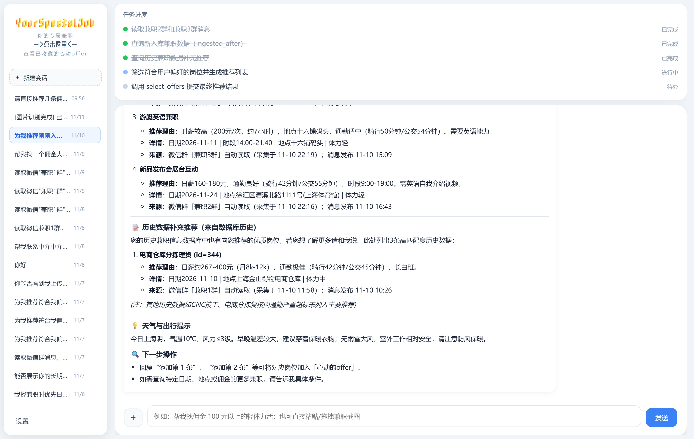
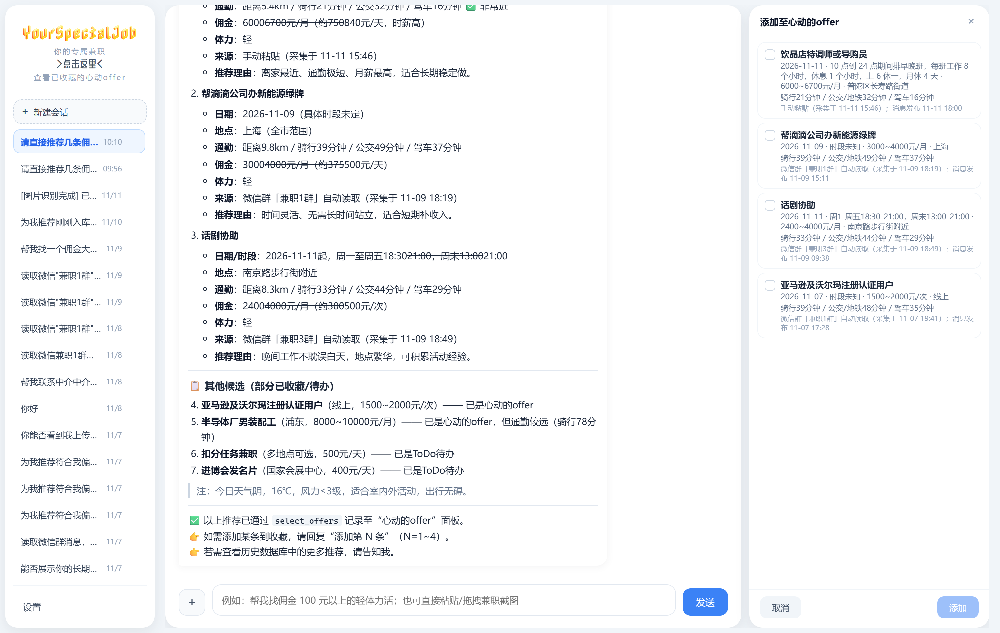
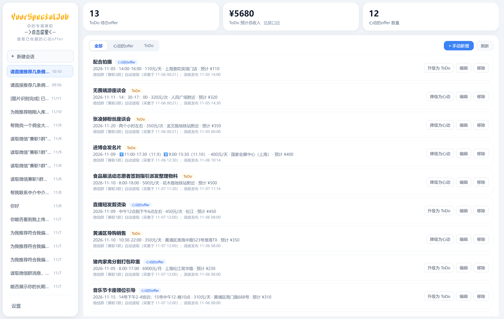
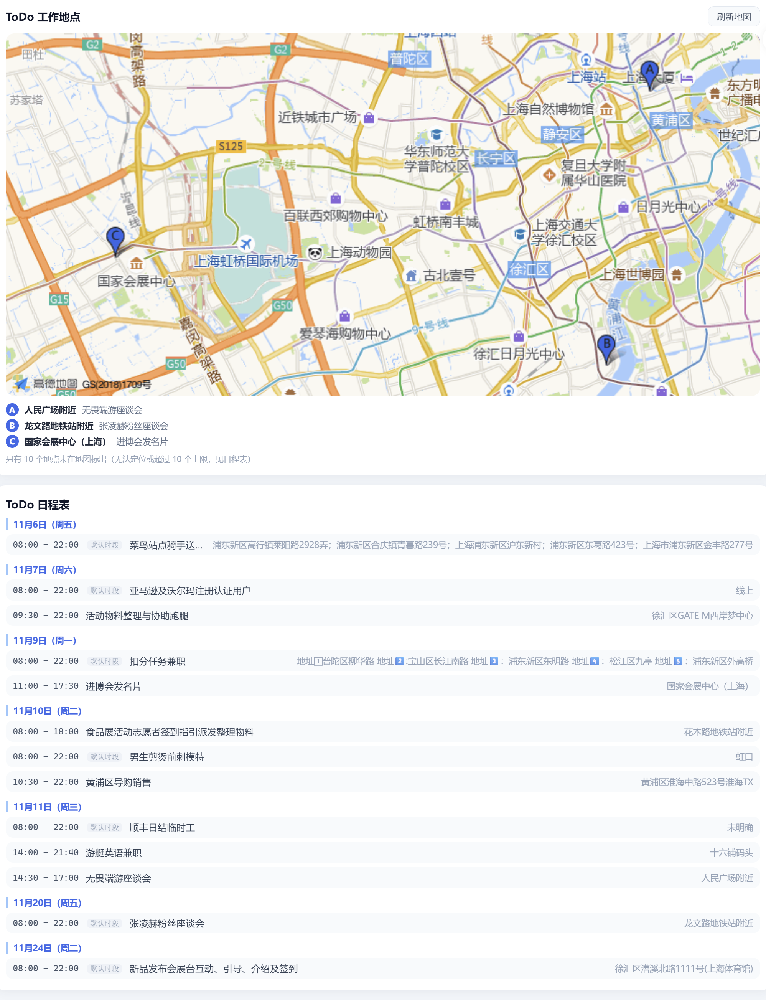
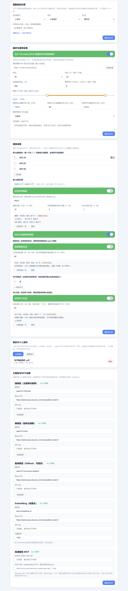
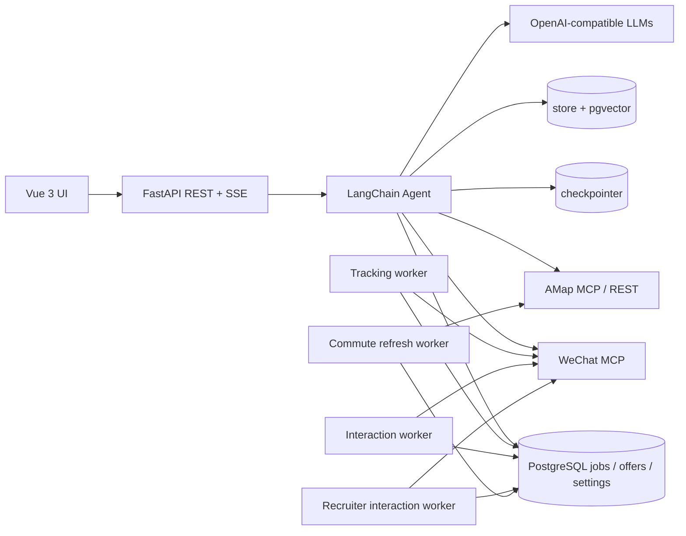

# YourSpecialJob

> A locally-run LLM agent that turns WeChat group messages into a part-time job shortlist.

[简体中文](README.md) | English

YourSpecialJob is a personal project for students who find part-time jobs in WeChat groups. It reads group messages through a WeChat MCP server, extracts structured job records with a small LLM, stores them in PostgreSQL, and lets the user ask for jobs in natural language. A stronger LLM combines SQL hard filters with soft ranking, then the results can be saved as favorites, promoted to ToDo, exported to PDF, or viewed on a map/schedule. Background workers also track new messages, push matching jobs to WeChat, and draft replies to recruiters from a resume RAG pipeline; replies are sent only after explicit user approval.

The design principle is not "let the model chat", but **put LLM uncertainty inside engineering boundaries**: job facts come from PostgreSQL, the model only extracts/ranks/drafts, risky actions go through HITL, and every pipeline has statistics and fallbacks.



## Screenshots

| OfferPanel after recommendations | Favorites / ToDo workbench |
|---|---|
|  |  |

| ToDo map and schedule | Settings |
|---|---|
|  |  |

> Screenshots come from a real local run and are for UI demonstration only.

## Features

- **Three ingestion channels**: automatic WeChat MCP reading (primary), paste, and screenshot transcription (fallback).
- **Structured extraction**: Pydantic schema, batched concurrency, `source_index` / `raw_text` lineage so the original message can be recovered even if the model rewrites it.
- **Three-layer deduplication**: in-run `content_hash` → JSONL ledger → PostgreSQL `UNIQUE(group_name, content_hash)`. JSONL is written only after a successful DB insert.
- **SQL hard filters + LLM soft ranking**: dates, overlapping commission ranges (with tolerance), physical intensity, and location keywords are filtered in SQL; semantic preferences and explanations are handled by the strong model.
- **Two-stage recommendations**: first the jobs ingested in this round, then 1-3 historical jobs. `select_offers(..., replace=True)` keeps the side panel consistent with the chat answer.
- **Favorites / ToDo workbench**: CRUD, status transitions, commission-midpoint income estimates, ToDo PDF export, static map with A-J legend, and a schedule grouped by date.
- **Long-term tracking**: incremental reads, fingerprint ledger, only newly ingested jobs are pushed, up to 3 retries, and each pushed item includes `id=xxx` so the user can reply "add item N" in WeChat.
- **WeChat interaction**: polls a target conversation, lets the agent reply, and supports "approve/reject" for HITL actions directly in WeChat.
- **Recruiter interaction**: rotates through recruiter conversations, drafts replies from the resume RAG, and requires confirmation from either the web card or WeChat before sending. Successful sends are recorded in an outbound ledger.
- **Resume RAG**: PDF/DOCX/TXT/MD → 500/50 chunks → 1024-dim embedding → pgvector HNSW cosine search.
- **Memory**: `AsyncPostgresSaver` for short-term state, `AsyncPostgresStore` for long-term preferences/facts, and `@dynamic_prompt` to inject explicit preferences and retrieved memories on every model call.
- **Frontend**: Vue 3 + Vite + Pinia + hash router; FastAPI SSE events: `token`, `todos`, `tool`, `progress`, `offers`, `hitl`, `error`, `done`.

## Architecture



- **Facts** live in PostgreSQL (`jobs`, offers/settings/push logs, resume vectors). Recommendations never invent facts.
- **Decisions** are handled by the agent (natural language, tool orchestration, soft ranking, drafts).
- **Deterministic pipelines** (ingestion, dedup, commute, tracking, send validation) are plain code.
- **External capabilities**: WeChat MCP (UI automation), AMap MCP/REST, OpenAI-compatible models.

## Tech stack

| Layer | Choice |
|---|---|
| Agent | LangChain 1.2 `create_agent`, LangGraph 1.1, middleware (Todo / Summarization / ModelRetry / ModelFallback / HITL) |
| Models | strong / weak / backup OpenAI-compatible endpoints; BGE-M3 1024-dim embedding by default |
| Backend | FastAPI, sse-starlette, psycopg 3, loguru |
| Database | PostgreSQL 17 + pgvector 0.8 (HNSW cosine) |
| Frontend | Vue 3.5, Vite 6, Pinia 3, vue-router 4, marked |
| Integrations | `mcp_server_wechat` in an isolated conda env, `@amap/amap-maps-mcp-server` or AMap REST |
| Tests | pytest + pytest-asyncio, ~503 tests, separate test database |

## Quick start

### Prerequisites

- Windows 10/11 for WeChat MCP (other features can run elsewhere)
- Python 3.13 + conda
- PostgreSQL 17 + pgvector 0.8 (the project uses a conda env `SggYourSpecialJobPG` and `pgdata/`)
- Node.js 20+
- An OpenAI-compatible strong / weak / backup model and embedding endpoint
- Optional: AMap Web Service key (commute, weather, static map)
- Optional: PC WeChat 3.9.12 (32-bit) + isolated conda env `SggWechatMCP` for automatic reading/sending

### Install

```bash
conda create -n SggLangchain1.2Practice python=3.13
conda activate SggLangchain1.2Practice
pip install -r requirements.txt
```

> `requirements.txt` is a full development export and contains many optional packages. The core runtime dependencies are `langchain`, `langgraph`, `langgraph-checkpoint-postgres`, `langchain-mcp-adapters`, `fastapi`, `uvicorn`, `sse-starlette`, `psycopg[binary]`, `psycopg-pool`, `pgvector`, `pydantic-settings`, `loguru`, `reportlab`, `pypdf`, `python-docx`, and `pillow`.

### Configure

```bash
cp .env.example agent/.env
```

Fill in at least the PostgreSQL, strong/weak model, and embedding settings. Optional variables: `AMAP_SERVER_KEY` / `AMAP_MAPS_API_KEY`, `AMAP_URL`, `WECHAT_SENDER_ID`, `WECHAT_MCP_PYTHON`, `PG_BINDIR`, `REPORT_FONT_PATH`.

### Database and backend

```bash
python scripts/start_pg.py
python scripts/init_db.py
python -m uvicorn backend.main:app --host 127.0.0.1 --port 8000 --reload
```

On Windows, `--reload` is required so uvicorn uses a `SelectorEventLoop` (psycopg 3.x does not support Proactor). The WeChat MCP Proactor loop runs in a separate thread.

### Frontend

```bash
cd frontend
npm install
npm run dev
```

Open <http://localhost:5173>.

### Optional: WeChat MCP

1. Create a 64-bit conda env `SggWechatMCP` and install `mcp_server_wechat==0.8`.
2. Keep PC WeChat 3.9.12 (32-bit) logged in; do not upgrade to 4.x.
3. Run `python scripts/patch_pywechat.py`.

The patch fixes the 64-bit import guard, process name detection, `send_delay`, multi-friend function names, page limits, and same-day page-boundary detection. Re-run it after rebuilding the isolated environment.

Without WeChat, you can still use screenshot upload, paste, or manual offer entry.

## Project layout

```text
agent/
  ├─ db/          # pool + DAOs + schema.sql
  ├─ tools/       # ingest / query_jobs / select_offers / report / resume / weather / send
  ├─ memory/      # dynamic prompt + long-term memory extraction
  ├─ prompts/     # system prompt + extraction prompt
  ├─ models/      # Pydantic schemas
  ├─ ingest.py    # shared ingestion pipeline
  ├─ tracking.py  # scheduled tracking + push
  ├─ interaction.py / contact_interaction.py
  ├─ amap_*.py    # commute / weather / static map / districts
  ├─ rag.py       # resume parsing, chunking, embedding, retrieval
  └─ graph.py     # agent assembly and middleware order
backend/
  ├─ main.py      # lifespan: pool / checkpointer / store / agent / workers
  ├─ sse.py       # astream → SSE events
  ├─ history.py   # checkpointer messages → frontend format
  └─ routers/     # chat / ingest / settings / sessions / offers / tracking / interaction / resume...
frontend/
  ├─ src/views/       # ChatView / SummaryView / SettingsView
  ├─ src/components/  # ChatInput / MessageList / OfferPanel / HITL / settings cards
  ├─ src/api/         # http.js / sse.js
  └─ src/stores/      # Pinia session store
scripts/          # start_pg / init_db / patch_pywechat / backfill_commute / probes
tests/            # pytest, separate database yourspecialjob_test
```

## Design notes

### Ingestion

`ingest_messages` is shared by all channels:

1. `_prefilter` removes noise (stickers/images/videos/files/voice/system messages) and repeated spam.
2. Batches are at most 3,000 characters / 20 messages; a single message is never split.
3. Up to 3 batches run concurrently through the weak model's `with_structured_output(ExtractedBatch)`; tool-calling failures fall back to `json_mode`.
4. `_reconcile_raw_text` recovers the authoritative source text via `source_index` + normalized text, and rebuilds `publish_time` from the WeChat message time (aware local time) instead of trusting a model-provided UTC marker.
5. Three-layer dedup: in-run `content_hash` → JSONL ledger → DB `UNIQUE(group_name, content_hash)`.
6. Newly inserted job ids are sent to the AMap MCP for commute calculations; failures are counted but do not block ingestion.

### Recommendations

`query_jobs` applies SQL hard filters: date range, overlapping commission range (30-unit tolerance), physical intensity, location keywords, group, source, and ingestion-time window. The strong model then ranks the candidates using explicit preferences and long-term memory.

For two-stage recommendations, the agent first queries `ingested_after` for the current batch, then `ingested_before` with `limit=3` for historical jobs. After writing the recommendation text it must call `select_offers`, which replaces the side panel and returns a numbered list so WeChat users can reply "add item N".

### Resume RAG

PDF via pypdf, DOCX via python-docx, TXT/MD via UTF-8 with a GB18030 fallback. `RecursiveCharacterTextSplitter` uses 500/50. Embeddings are forced to 1024 dimensions; `resume_chunks.embedding vector(1024)` uses HNSW `vector_cosine_ops`; search score is `1 - (embedding <=> query)`, top 4 by default. The system prompt requires `search_resume` before answering recruiter questions or writing self-introductions, and forbids inventing experience.

### HITL

`HumanInTheLoopMiddleware` intercepts only `export_job_report` and `send_wechat_message_to_contact`. The interrupt state is persisted by the checkpointer + `thread_id`. The web resumes via `POST /api/chat/resume`; WeChat stores pending actions in `interaction_pending` (24h TTL) and resumes after the user replies "approve/reject". `ToolCallRepairMiddleware` must stay inside HITL so repaired tool calls still require approval.

### Tracking

Each round reloads preferences from the DB. Message fingerprints (`sha256(group|day|sender|time|normalize(text))[:32]`) filter messages before the LLM, then the jobs `content_hash` filters known content. Only jobs ingested in the current round (`round_start - 60s`) are pushed; favorites, expired jobs, unknown commissions, and jobs over commute limits are excluded. `push_log` records sent/failed/skipped with at most 3 attempts. The summary is template-based and includes `id=xxx` for each item.

### WeChat / recruiter interaction

WeChat MCP is UI automation, so all reads/writes are serialized with `ingest_run_lock` → `wechat_window_lock`; `agent.ainvoke` never holds the window lock (tools acquire it internally, avoiding deadlock). Background workers use PostgreSQL advisory locks for single-instance execution.

Recruiter interaction reads one recruiter per round (least recently polled first), filters robot prefixes and the outbound ledger, and drafts the latest 3 messages even on the baseline round. Drafts require confirmation from the web card or WeChat; `claim_pending` uses `DELETE ... RETURNING` so only one channel can consume a pending action.

## API / SSE

| Endpoint | Purpose |
|---|---|
| `POST /api/chat/stream` | SSE chat |
| `POST /api/chat/resume` | Resume after HITL approval |
| `POST /api/wechat/ingest` | Read a group/date and ingest |
| `POST /api/upload/screenshot` | Screenshot ingestion |
| `GET/PUT /api/settings` | Read/save settings (DB overrides `.env`) |
| `GET/POST/PATCH/DELETE /api/offers...` | Offer CRUD, status, export, map |
| `GET /api/sessions`, `GET /api/sessions/{id}/messages` | Sessions and history |
| `GET /api/tracking/status`, `POST /api/tracking/run` | Tracking status / run now |
| `GET /api/interaction/...` | Interaction and recruiter status/pending/approval |
| `POST /api/resume/upload`, `POST /api/resume/rebuild` | Resume upload / reindex |
| `GET /api/health` | PG, model config, workers |

SSE events: `meta`, `token`, `todos`, `tool`, `progress`, `offers`, `hitl`, `done`, `error`. The frontend normalizes `\r\n` to `\n` before splitting frames and uses a 45-second watchdog.

## Tests

```bash
pytest -q
cd frontend && npm run build
```

- About 503 pytest cases in a separate database `yourspecialjob_test`.
- API tests use `httpx.AsyncClient + ASGITransport` without lifespan, so background workers are not started.
- External services (LLM / WeChat / AMap) are replaced with fakes.
- Real integrations are validated manually with `scripts/probe_*.py` (SSE, HITL, WeChat read/send, AMap, ingestion idempotency, screenshots).

## Roadmap

- Offline evaluation sets and metrics for extraction, recommendation, and RAG (field accuracy, Recall@k, human relevance).
- Rerank / hybrid retrieval for resume RAG.
- Feedback loop from favorites, ignores, and rejections.
- Outbox + worker for long-term memory extraction and push retries.
- Markdown XSS sanitization and local-time date utilities.
- Multi-user auth, task queue, monitoring, and other production capabilities.

## Disclaimer

This is a personal learning and portfolio project. WeChat automation is intended for a locally logged-in client only; comply with WeChat's terms and applicable laws. Do not use it for mass scraping, spam, or unauthorized data collection. The project does not guarantee the authenticity of any job posting; verify recruiters independently.

## License

[MIT](LICENSE)
