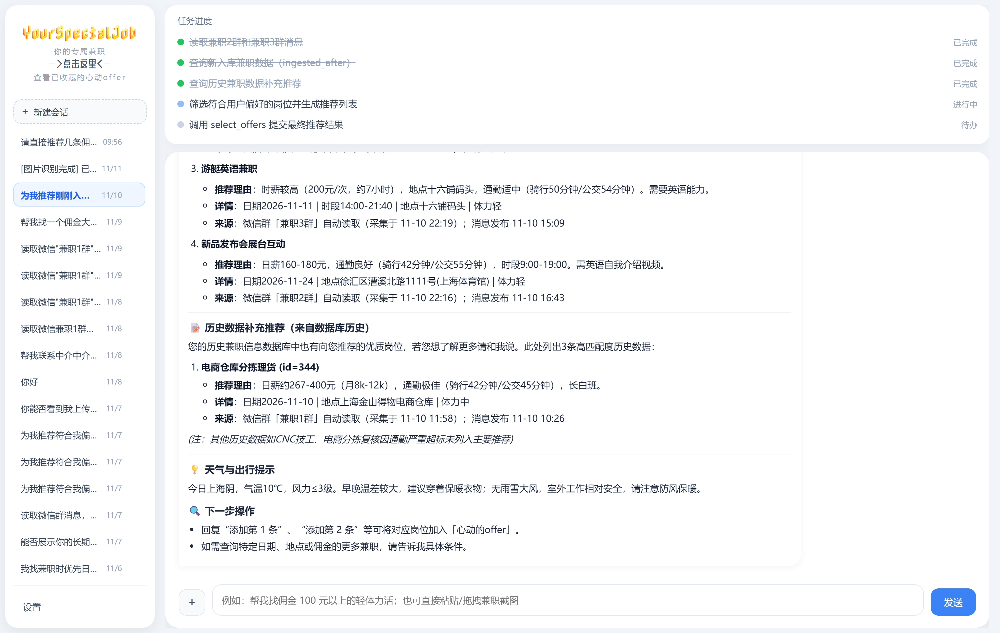
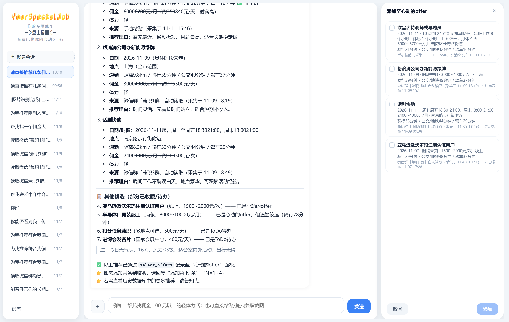
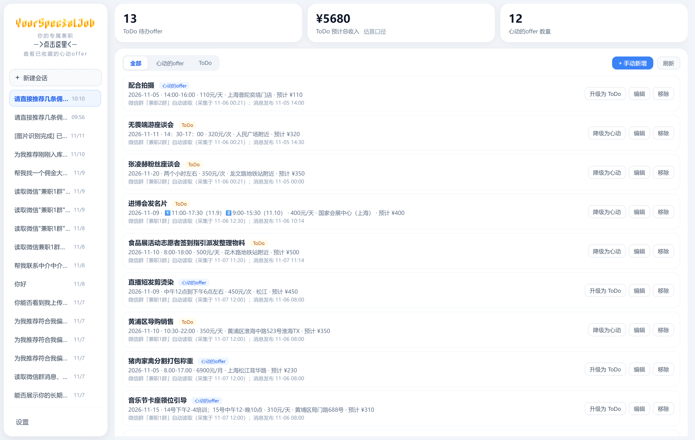
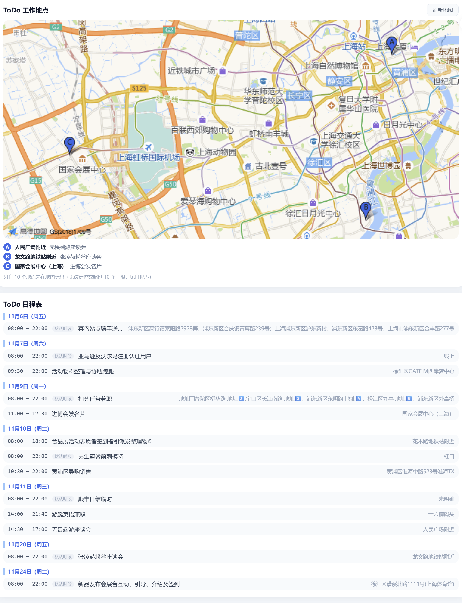
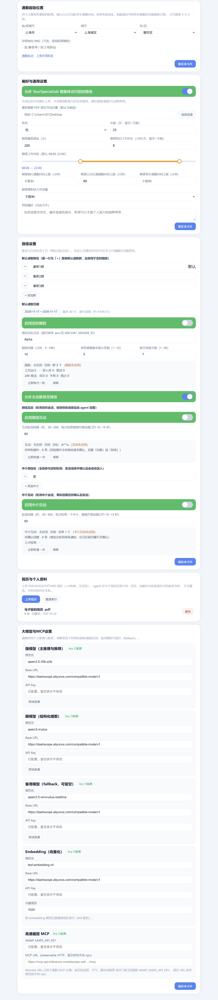
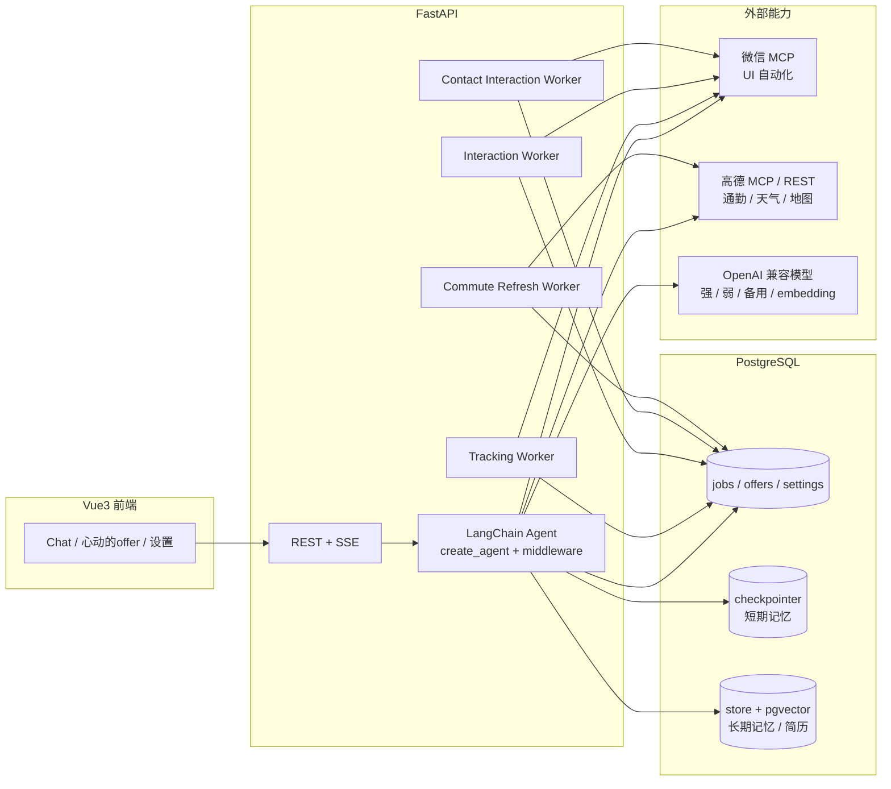

# YourSpecialJob

> 从微信群消息到「心动的offer」——一个本地运行的大模型兼职 Agent

[English](README.en.md) | 简体中文

YourSpecialJob 面向在微信群里找兼职的学生：自动读取群消息，用弱模型把自由文本结构化成兼职记录，存入 PostgreSQL；用户用自然语言提出日期、佣金、地点等要求，Agent 调 SQL 硬过滤 + LLM 软排序给出推荐；推荐可以加入「心动的offer」、升级为 ToDo、导出 PDF、查看地图与日程；后台还会定时跟踪新消息、命中偏好后推送微信，并基于简历 RAG 草拟给中介的回复，经用户确认后发送。

项目重点不是“让模型聊天”，而是把 **LLM 的不确定性**放进可控的工程边界：兼职事实以数据库为准，模型只做抽取、排序和草稿；危险操作走 HITL；摄入、去重、推送都有统计与失败兜底。



## 界面预览

| OfferPanel：推荐后三步收藏 | 心动的offer 工作台 |
|---|---|
|  |  |

| ToDo地图与日程表 | 设置页 |
|---|---|
|  |  |

> 截图来自本地真实运行环境，仅用于展示界面。

## 功能

- **三种摄入通道**：微信 MCP 自动读取（主路径）、手动粘贴、聊天截图多模态识别（兜底）。
- **弱模型结构化**：Pydantic schema + 分批并发 + `source_index`/`raw_text` 血缘回填；模型改写时仍能回溯原文。
- **三层去重**：run 内 `content_hash` → jsonl 已见记录 → PostgreSQL `UNIQUE(group_name, content_hash)`；DB 成功后才写 jsonl。
- **SQL 硬过滤 + LLM 软排序**：日期、佣金区间重叠（带容差）、体力强度、地点关键词走 SQL；语义偏好和推荐理由交给强模型。
- **两段式推荐**：先推本轮新入库，再补历史库 1~3 条；`select_offers` 用 `replace=True` 保证右侧面板与左侧推荐一致。
- **心动的offer 工作台**：列表增删改查、favorite/ToDo 状态流转、佣金中值收入估算、ToDo PDF、静态地图（A-J 图例）、按日期分组的日程表。
- **长期跟踪**：定时读群、指纹账本前置过滤、只推本轮新入库、失败重试（最多 3 次）、推送摘要带 `id` 方便微信按编号收藏。
- **微信互动**：轮询目标会话 → Agent 回复 → 回发微信；HITL 危险操作可在微信回复「同意/拒绝」。
- **中介互动**：轮换读取中介会话，基于简历 RAG 草拟回复，网页卡片 / 微信审批双通道确认，发送成功写做出站账本。
- **简历 RAG**：PDF/DOCX/TXT/MD → 500/50 切块 → 1024 维 embedding → pgvector HNSW 余弦检索。
- **记忆**：`AsyncPostgresSaver` 短期记忆 + `AsyncPostgresStore` 长期偏好/事实；`@dynamic_prompt` 每次调用注入显式偏好与长期记忆。
- **前端**：Vue3 + Vite + Pinia + hash 路由；FastAPI SSE 流式输出，含 token/todo/tool/progress/offers/hitl/error/done 事件。

## 架构



核心分层：

- **事实层**：PostgreSQL 的 `jobs`、`offers`、`settings`、`push_log`、简历向量等。所有推荐事实来自这里。
- **决策层**：Agent 负责自然语言理解、工具编排、软排序、草稿；确定性管道（摄入、去重、通勤、跟踪、发送校验）用代码实现。
- **外部能力层**：微信 MCP（读写窗口）、高德 MCP/REST（通勤、天气、静态地图）、OpenAI 兼容模型。
- **交互层**：Vue3 聊天页 + SSE；心动的offer 工作台；设置页。

## 技术栈

| 模块 | 选型 |
|---|---|
| Agent | LangChain 1.2 `create_agent`、LangGraph 1.1、中间件（Todo / Summarization / ModelRetry / ModelFallback / HITL） |
| 模型 | 强 / 弱 / 备用三档 OpenAI 兼容接口；embedding 默认 BGE-M3 1024 维 |
| 后端 | FastAPI、sse-starlette、psycopg 3、loguru |
| 数据库 | PostgreSQL 17 + pgvector 0.8（HNSW 余弦索引） |
| 前端 | Vue 3.5、Vite 6、Pinia 3、vue-router 4、marked |
| 外部集成 | `mcp_server_wechat`（隔离 conda 环境）、`@amap/amap-maps-mcp-server` / 高德 REST |
| 测试 | pytest + pytest-asyncio；约 503 个用例；独立测试库 |

## 快速开始

### 前置条件

- Windows 10/11（微信 MCP 是 PC 微信 UI 自动化；其他功能可在其他系统运行）
- Python 3.13 + conda
- PostgreSQL 17 + pgvector 0.8（本项目用 conda 环境 `SggYourSpecialJobPG` 提供 server，数据目录 `pgdata/`）
- Node.js 20+
- 一个 OpenAI 兼容的强/弱/备用模型与 embedding 服务
- 可选：高德 Web 服务 key（通勤、天气、静态地图）
- 可选：PC 微信 3.9.12（32 位版）+ 隔离 conda 环境 `SggWechatMCP`（自动读取/发送）

### 1. 安装依赖

```bash
conda create -n SggLangchain1.2Practice python=3.13
conda activate SggLangchain1.2Practice
pip install -r requirements.txt
```

> `requirements.txt` 是开发环境导出，包含较多可选依赖。核心运行依赖是 `langchain`、`langgraph`、`langgraph-checkpoint-postgres`、`langchain-mcp-adapters`、`fastapi`、`uvicorn`、`sse-starlette`、`psycopg[binary]`、`psycopg-pool`、`pgvector`、`pydantic-settings`、`loguru`、`reportlab`、`pypdf`、`python-docx`、`pillow`。

### 2. 配置

```bash
cp .env.example agent/.env
```

编辑 `agent/.env`，至少填写：

```dotenv
POSTGRES_HOST=localhost
POSTGRES_PORT=5432
POSTGRES_USER=postgres
POSTGRES_DB=yourspecialjob

STRONG_MODEL=...
STRONG_API_KEY=...
STRONG_BASE_URL=...

WEAK_MODEL=...
WEAK_API_KEY=...
WEAK_BASE_URL=...

EMBEDDING_MODEL=...
EMBEDDING_API_KEY=...
EMBEDDING_BASE_URL=...
EMBEDDING_DIMS=1024
```

可选变量：`AMAP_SERVER_KEY` / `AMAP_MAPS_API_KEY`（高德 Web 服务 key）、`AMAP_URL`（Remote MCP）、`WECHAT_SENDER_ID`（推送/互动目标）、`WECHAT_MCP_PYTHON`（隔离环境 python）、`PG_BINDIR`（PostgreSQL bin 目录）、`REPORT_FONT_PATH`（PDF 中文字体）。

### 3. 启动 PostgreSQL 与建表

```bash
python scripts/start_pg.py
python scripts/init_db.py
```

`start_pg.py` 会在 `pgdata/` 不存在时自动 `initdb`（trust 本地认证），并启动 conda 环境里的 PostgreSQL。若你的 PG 安装路径不同，设置 `PG_BINDIR`。

### 4. 启动后端

```bash
python -m uvicorn backend.main:app --host 127.0.0.1 --port 8000 --reload
```

Windows 上必须带 `--reload`：uvicorn 子进程模式会自动使用 `SelectorEventLoop`，psycopg 3.x 不支持 Proactor。微信 MCP 的 Proactor 循环在独立线程里运行。

### 5. 启动前端

```bash
cd frontend
npm install
npm run dev
```

打开 <http://localhost:5173>。

### 6. 可选：微信 MCP

自动读取/发送需要：

1. 安装 64 位 Python 的隔离 conda 环境 `SggWechatMCP`，安装 `mcp_server_wechat==0.8` 及其依赖；
2. 保持 PC 微信 3.9.12（32 位版）登录，勿升级 4.x；
3. 运行补丁脚本：

```bash
python scripts/patch_pywechat.py
```

补丁修复了 64 位导入检查、微信进程名、`send_delay`、多好友函数名、翻页上限、同日跨页误判，并在读取/发送后关闭微信主窗口。重建隔离环境后需要重新运行。

没有微信环境也可以使用：聊天页「+」菜单上传截图、直接粘贴群消息，或在心动的offer 工作台手动录入。

## 目录结构

```text
agent/
  ├─ db/          # 连接池、jobs/offers/settings/sessions/tracking/interaction/resume DAO、schema.sql
  ├─ tools/       # ingest / manual_ingest / query_jobs / select_offers / add_to_offers /
  │               # search_resume / export_job_report / get_today_weather / send_wechat_message_to_contact
  ├─ memory/      # 短期/长期记忆 prompt 与偏好提取
  ├─ prompts/     # 系统提示词、结构化提取提示词
  ├─ models/      # Pydantic schema（兼职、提取、offer、记忆）
  ├─ ingest.py    # 摄入公共管道（预过滤/分批/并发/血缘/三层去重）
  ├─ mcp_wechat.py# 微信 MCP 封装（独立 Proactor 线程）
  ├─ tracking.py  # 长期跟踪调度与推送
  ├─ interaction.py / contact_interaction.py  # 用户互动 / 中介互动
  ├─ amap_*.py    # 高德 MCP、通勤、天气、静态地图、区划
  ├─ rag.py       # 简历解析/切块/embedding/检索
  └─ graph.py     # Agent 装配与中间件顺序
backend/
  ├─ main.py      # lifespan：连接池/checkpointer/store/agent/后台 worker
  ├─ sse.py       # astream → SSE 事件映射
  ├─ history.py   # checkpointer 消息 → 前端格式
  └─ routers/     # chat/ingest/settings/sessions/upload/offers/reports/tracking/interaction/commute/resume/system
frontend/
  ├─ src/views/       # ChatView / SummaryView / SettingsView
  ├─ src/components/  # ChatInput / MessageList / OfferPanel / HitlDialog / settings 卡片等
  ├─ src/api/         # http.js / sse.js
  └─ src/stores/      # Pinia session store
scripts/          # start_pg / init_db / patch_pywechat / backfill_commute / probe_*
tests/            # pytest（独立测试库 yourspecialjob_test）
agent/db/schema.sql
```

## 核心设计

### 1. 摄入管道

`ingest_messages` 是所有通道的公共入口：

1. `_prefilter`：过滤表情/图片/视频/文件/语音/系统消息与原文刷屏重复；
2. `_chunk_messages`：每批 ≤3000 字、≤20 条，单条消息不跨批；
3. 最多 3 批并发调用弱模型 `with_structured_output(ExtractedBatch)`；tool-calling 失败降级 `json_mode`；
4. `_reconcile_raw_text`：按 `source_index` + 归一化原文双路回溯权威原文；发布时间以微信消息时刻重新合成（aware 本地时间），不信任模型可能误标的 UTC；
5. 三层去重：run 内 `content_hash` → jsonl 已见 → DB `UNIQUE(group_name, content_hash)`；
6. 新插入的 job id 交给高德 MCP 计算通勤，失败只计数、不阻塞入库。

### 2. 推荐

`query_jobs` 做 SQL 硬过滤：日期区间、佣金区间重叠（默认 30 元容差）、体力强度、地点关键词、群名、来源、入库时间窗口。强模型再结合显式偏好与长期记忆做软排序。

两段式推荐：本轮有新入库时，先 `query_jobs(ingested_after=...)` 推新数据，再 `query_jobs(ingested_before=..., limit=3)` 补历史；推荐完成后必须调用 `select_offers`，用 `replace=True` 覆盖右侧面板，并返回带编号的清单，支持微信「添加第 N 条」。

### 3. 简历 RAG

PDF 用 pypdf、DOCX 用 python-docx、TXT/MD 先 utf-8 再 gb18030 回退；`RecursiveCharacterTextSplitter` 500/50；embedding 维度强制为 1024；`resume_chunks.embedding vector(1024)` + HNSW `vector_cosine_ops`；检索用 `1 - (embedding <=> query)` 作为相似度，默认 top 4。回答中介问题、写自我介绍前，系统提示词要求先调用 `search_resume`，只引用检索到的事实。

### 4. HITL

`HumanInTheLoopMiddleware` 只拦截两个工具：`export_job_report`、`send_wechat_message_to_contact`。中断状态由 checkpointer + `thread_id` 保存；网页走 `POST /api/chat/resume`，微信端把 pending 存入 `interaction_pending`（TTL 24h），用户回复「同意/拒绝」后执行 `Command(resume=...)`。修复非法工具参数的 `ToolCallRepairMiddleware` 必须放在 HITL 内层，保证修复后的发送调用仍被审批。

### 5. 长期跟踪

每轮从 DB 重读 preferences；消息指纹 `sha256(group|day|sender|time|normalize(text))[:32]` 前置过滤，再用 jobs 的 `content_hash` 二次过滤；只推本轮新入库（`round_start - 60s` 起），排除已收藏/过期/佣金未知/超通勤上限；推送日志 `push_log` 记录 sent/failed/skipped，失败最多重试 3 次；摘要模板拼接，每条工作内容带 `id=xxx`。

### 6. 微信 / 中介互动

微信 MCP 是 UI 自动化，所有读写必须串行：`ingest_run_lock` → `wechat_window_lock`，且 `agent.ainvoke` 期间不持窗口锁（工具内部会再次申请，避免死锁）。后台 worker 用 PostgreSQL advisory lock 保证多实例单跑。

中介互动每轮只读一个中介（最久未读优先），过滤机器人前缀与出站账本，基线轮也草拟最近 3 条；草稿经网页卡片或微信「同意/拒绝」确认后发送；`claim_pending` 用 `DELETE ... RETURNING` 原子领取，双通道只有一个能处理。

## API 与 SSE

主要接口：

| 路径 | 说明 |
|---|---|
| `POST /api/chat/stream` | SSE 流式聊天 |
| `POST /api/chat/resume` | HITL 审批后恢复 |
| `POST /api/wechat/ingest` | 按群 + 日期读取微信并入库 |
| `POST /api/upload/screenshot` | 截图识别入库 |
| `GET/PUT /api/settings` | 读取/保存设置（DB 覆盖 .env） |
| `GET/POST/PATCH/DELETE /api/offers...` | 心动的offer CRUD、状态流转、导出、地图 |
| `GET /api/sessions`、`GET /api/sessions/{id}/messages` | 会话列表与历史回放 |
| `GET /api/tracking/status`、`POST /api/tracking/run` | 跟踪状态/立即执行 |
| `GET /api/interaction/status`、`/contact-status` 等 | 互动/中介状态、待确认、确认 |
| `POST /api/resume/upload`、`POST /api/resume/rebuild` | 简历上传、重建索引 |
| `GET /api/health` | PG / 模型配置 / worker 状态 |

SSE 事件：`meta`、`token`、`todos`、`tool`、`progress`、`offers`、`hitl`、`done`、`error`。前端 `sse.js` 会把 `\r\n` 归一化为 `\n` 再按空行切帧，并有 45 秒断线看门狗。

## 测试

```bash
pytest -q
cd frontend && npm run build
```

- 约 503 个 pytest 用例，使用独立测试库 `yourspecialjob_test`；
- API 测试用 `httpx.AsyncClient + ASGITransport`，不跑 lifespan，避免启动后台 worker；
- 外部依赖（LLM/微信/高德）在测试中用 Fake 隔离；
- 真实链路由 `scripts/probe_*.py` 人工验证（SSE、HITL、微信读取/发送、高德、摄入幂等、截图等）。

## Roadmap

- 抽取/推荐/RAG 的离线评测集与指标（字段准确率、Recall@k、人工相关性）；
- 简历 RAG 增加 rerank / hybrid（BM25 + 向量）；
- 推荐反馈闭环（收藏、忽略、拒绝作为信号）；
- 把长期记忆提取与推送重试改成 outbox + worker；
- 前端 Markdown XSS 清洗与本地时区日期工具；
- 多用户/鉴权/任务队列/监控告警等生产化能力。

## 免责声明

本项目是个人学习与求职作品集项目。微信自动化仅用于本人已登录的本地客户端，请遵守微信服务条款与相关法律法规；不要用于大规模抓取、骚扰或未授权的数据收集。项目不提供任何兼职信息的真实性担保，请自行核验招聘方。

## License

[MIT](LICENSE)
